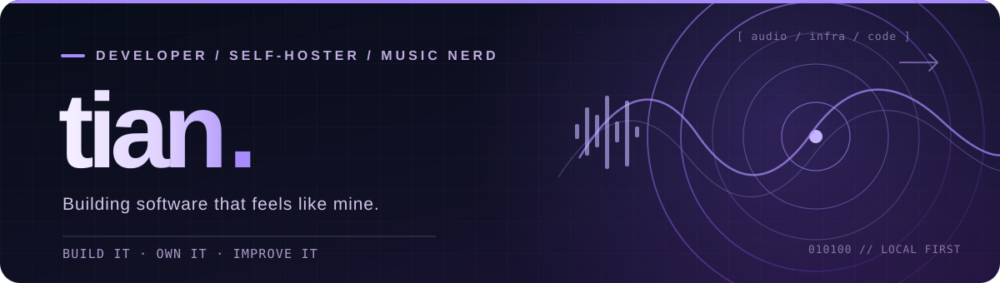
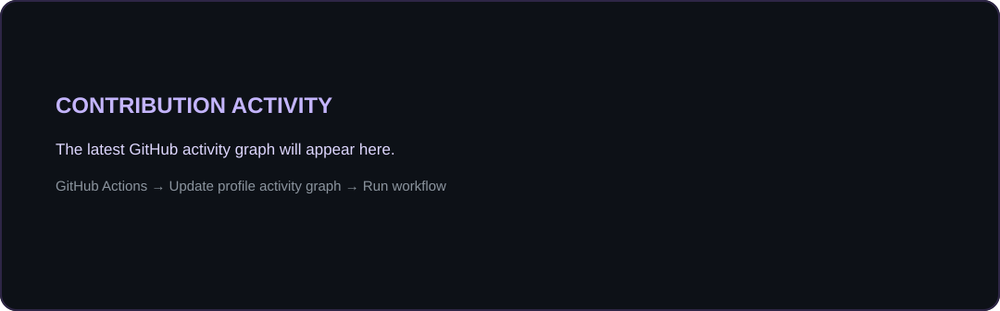

<!--
  GitHub profile README for https://github.com/Tian-MC
  The banner is stored locally at assets/tian-banner.svg.
  The contribution activity graph is generated daily by GitHub Actions.
  Other live widgets use third-party services and may sometimes be unavailable.
-->

  

   

  
  
  

   
   

  

## `> whoami`

Hey! I'm **Tian (Cristian Colletti)**, a developer from Italy who enjoys turning complicated problems into useful tools.

I'm especially interested in **web applications, Linux infrastructure, automation, local AI and self-hosted media**. I like software that gives people more control over their own data — and I have a soft spot for anything involving music and synchronized lyrics.

- **Building:** [Lyvune](https://github.com/Tian-MC/lyvune), a self-hosted music experience built on Navidrome.
- **Exploring:** practical AI integrations, developer tooling and reliable self-hosted infrastructure.
- **Away from the keyboard:** symphonic/power metal, audio gear, rhythm games and the occasional *"I could self-host that"* moment.

## ✦ Featured project

**Your music. Fully yours.**

Lyvune is a self-hosted music server and web player built on [Navidrome](https://www.navidrome.org/), with a redesigned listening experience, **word-by-word karaoke lyrics**, and **multilingual romanization**. It keeps compatibility with the Subsonic/OpenSubsonic ecosystem.

  

  <a href="https://github.com/Tian-MC/lyvune"><b>Explore Lyvune →</b></a>

## ✦ Other projects

| Project | What it does | Stack |
| :--- | :--- | :--- |
| **[SyncedLyricsTool](https://github.com/Tian-MC/SyncedLyricsTool)** | Finds synchronized LRC lyrics and embeds them into MP3/FLAC metadata. | `Python` |
| **[Crunchyroll Downloader](https://github.com/Tian-MC/crunchyroll-downloader)** | A maintained fork with download fixes, language selection and MKV output for content you're authorized to access. | `Go` |

## ✦ Toolbox

**Languages & web**

  

**Infrastructure & workflow**

  

`Arch Linux` · `Debian / Ubuntu` · `Docker` · `Self-hosting` · `Automation` · `Ollama / local LLMs`

## ✦ GitHub telemetry

  
  

  

Activity graph generated daily from GitHub contribution data using GitHub Actions. Other stats use third-party services and may occasionally be unavailable. GitHub visibility settings affect what is counted.

## ✦ Beyond code

I love **symphonic metal**, lossless audio, **osu!**, and experimenting with how technology can make a music library feel truly personal. Sometimes that means writing a feature. Sometimes it means spending an evening tuning a Linux server.

   
  
  

   
   
  Build it. Own it. Improve it.

